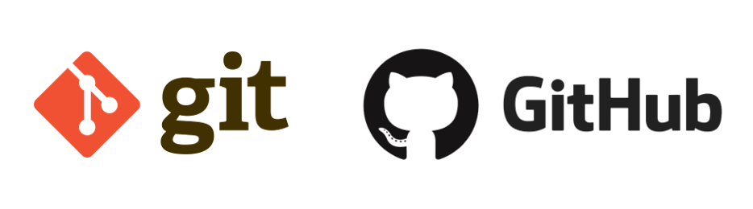

<!-- 
 -->

# PART 1 - Git Basics

Learn to install and configure Git, then perform basic version control operations while creating a simple website.

Also see: [PART 2 - Git Collaboration](git-collaboration.md)

## Instructions

1. Complete the below steps, adding content in the [completions](#completions) table when ✏️ prompted
1. Review course content as needed. You may need to read the documentation as well.
1. After you finish, celebrate your Git proficiency! 🙌


## 1. Install and Configure Git

Follow [these instructions](./how-to/install-configure.md)


## 2. Fork this repository

If you're new to Markdown, start with this [Markdown Introduction](./how-to/markdown.md). Then create a Github account and make your first commit on Github.com

1. [Create a Github account](https://github.com/join)
1. Fork this [learn-git-milestones](https://github.com/omundy/learn-git-milestones) repository (click the Fork button, top right).
1. ✏️ Edit this `README.md` file (click the pencil icon on the Github.com page) and add your *1st* favorite emoji to the **Completed** column in appropriate row in the [completions [2-1]](#completions) section, below.
1. Commit your changes to this file to the `main` branch with the message `commit #1 from Github.com`.
1. ✏️ Use [Markdown documentation](https://guides.github.com/features/mastering-markdown/) to add a link in [completions [2-2]](#completions). The link text should be the same as the commit message, and the url should point to the Github.com page showing the above commit.
1. ✏️ Tables can be a little tricky in Markdown. Use a search engine to find a good link explaining how to use markdown tables and paste it in the [completions [2-3]](#completions) table.
1. View the commit history and confirm your edits
1. ✏️ What does `git log` do? Add your answer to [completions [2-4]](#completions).


## 3. Git Workflow > Github Desktop

With Git installed on your computer you can perform a basic Git workflow using Github Desktop. This is the first of a few different interfaces to give you practice with Git. You've already forked and made a commit on Github.com so let's move to Github Desktop ...


### Install Github Desktop

1. Install [Github Desktop](https://desktop.github.com/) on your computer
1. Connect your Github account in Github Desktop

### Clone the repository

In Github Desktop, clone the fork of this repository that you made above...

1. Select File > Clone Repository > Github.com and select it ...
1. Local Path: The default location is usually fine: `/Users/<username>/Documents/Github/` (or the equivilant on Windows). You can also use a folder specific to your class name, as long as it doesn't have spaces (e.g. `critical-web-design`)
1. Click "Clone" to finish. This will save a local copy of the repository on your computer and make it available to Github Desktop.

### Use Github Desktop with VS Code

1. Install [VS Code](https://code.visualstudio.com/) on your computer
1. In Github Desktop, open the repo in VS Code: Repository > Open in VS Code (see preferences to change your editor)
1. ✏️ In VS Code, edit this README file and add your *2nd* favorite emoji to [completions [3-1]](#completions) and save the file.
1. In Github Desktop, view/confirm your edits to the README file on the Changes tab
1. Commit your changes directly to the main branch with the message `commit #2 from Github Desktop`. 
1. Click Push origin to push your new commit to the remote repo
1. Choose Repository > View on Github.
1. Click on the README file and then click History to see the history of this file
1. Click on the above commit (`#2`) and copy the URL. Use VS Code to add it to [completions [3-2]](#completions) . Commit your change in Github Desktop.


## 4. Git Workflow > Command line (CLI)

Some folks use the CLI as their default tool for editing and publishing source code, but Github Desktop makes it much easier.

### Setup

1. In Github Desktop, ensure you are currently in the [learn-git-milestones](https://github.com/omundy/learn-git-milestones) repo you cloned above.
1. Click Repository > Open in Terminal ("Bash" in Windows) (You can change to preferred shell in Github Desktop > File > Options > Integrations)

### Use the CLI to navigate directories

1. List files in this directory: `ls`
1. List files in this directory, including hidden: `ls -la`
1. Confirm the existence of the `.git` directory (where Git versions and config are stored)
1. View your current working directory and copy the full path: `pwd`
1. ✏️ Open this README file in VS Code and paste that path in [completions [4-1]](#completions).


### Use Git on the CLI

1. [Confirm](https://docs.github.com/en/github/using-git/setting-your-username-in-git) your name and email is correct in the Git config
1. View the status of your repo: `git status`
1. View the changed files of your repo: `git diff`
1. Add all changed files to the staging area `git add .`
1. View the status of your repo `git status` to confirm it has been staged
1. ✏️ Commit your changes with the message `commit #3 from CLI`. Add a link to this commit to [completions [4-2]](#completions).
1. Use `git push` to [push those changes to your remote repo](https://docs.github.com/en/github/using-git/pushing-commits-to-a-remote-repository)


You've used most of these already through a GUI (e.g. `git status`, `git add`, `git commit`, `git push`) ...


## 5. Create a website with Git


### Create a new repository in Github Desktop

1. Select File > New repository to create a new repository with the following... 
2. Name: `first-website`
3. Local Path: Click "Choose" and select the parent folder of the repository you cloned above (so that the new repository folder will be created next to `learn-git-milestones`, not inside of it!)

```html
<parent-folder> <-THIS!
|-- first-website 
|-- learn-git-milestones
```

4. Initialize this repository with a README? `yes`
5. Git Ignore: Select any option (we will overwrite below)
6. License: `MIT`
7. Click Create Repository


### Add a README.md

1. In Github Desktop choose Repository > Open in VS Code
1. Add a README file: `README.md`
1. In the README write your name and the date
1. Use some [Markdown tags](https://guides.github.com/pdfs/markdown-cheatsheet-online.pdf)


### Add a .gitignore file

A `.gitignore` file will prevent git from adding unwanted files to your repository.

1. In VS Code, add a new file named `.gitignore`. The period in front will hide the file from the Finder (or Explorer) but it will still be visible in VS Code.
1. Copy the contents of either the [MacOS](https://github.com/github/gitignore/blob/33243d9491911332228307c915ff95707791a91f/Global/macOS.gitignore) or [Windows](https://github.com/github/gitignore/blob/33243d9491911332228307c915ff95707791a91f/Global/Windows.gitignore) `.gitignore` files and paste it into your own.
1. Commit your changes using Github Desktop. 


### Add an index.html file

1. In VS Code, create a file named `index.html` in your new repo 
2. Add the following code

```html
<!DOCTYPE html>
<html lang="en">
	<head>
		<meta charset="utf-8">
		<title>My first github.io website</title>
	</head>
	<body>
		<h1>Hello, World!</h1>
		<p>🙌</p>
	</body>
</html>
```

3. Commit your changes using Github Desktop.


### Publish this repository on Github.

1. In Github Desktop, click "Publish this repository on Github"
1. Make sure the repository is public *not private* 
1. Click Publish Repository
1. Choose Repository > View on Github
1. ✏️ Add a link to this repo on Github to [completions [5-1]](#completions).


## 6. Publish a website with Github Pages

Now that your files are on Github you can use [Github Pages](https://pages.github.com/), a free and easy way to host a website from your repository. 

1. On Github.com, go to your repository > Settings > Pages
1. Source: Deploy from Branch
1. Branch: Select the `main` and `/(root)` folder and click Save
1. Do not use a theme. Start from scratch
1. Wait about 60 seconds and refresh the page. You will see a link at the top that says "Your site is live at..." with a URL that looks like `http://*username*.github.io/first-website`
1. Update your index.html page with VS Code, push a new commit with Github Desktop, and confirm your updates are live. You can see the status of your deployments from the link on your main repo page.
1. ✏️ Paste a link to the ***live*** (github.io) website in [completions [6-1]](#completions).


🎉 Congratulations! 🎉 You just built a website with Git and Github!!


## Turn in this Assignment

Now that we have basic Git commands out of the way use Git to create and turn in your assignment ...

1. Complete all of the items on this README, making sure all the rows in the "Completed" column contain your information below.
1. Test your file(s) in a web browser
1. Commit and push the files to Github
1. Paste the github.io link into the appropriate Moodle forum


## Completions

Step | Description | Completed
--- | --- | ---
2-1 | 1st Favorite emoji | 🦝
2-2 | Link to `commit #1 from Github.com` |
2-3 | Link to markdown tables docs |
2-4 | What does `log` do? |
3-1 | 2nd Favorite emoji |
3-2 | Link to `commit #2 from Github Desktop` |
4-1 | Full path to your working directory |
4-2 | Link to `commit #3 from CLI` |
5-1 | Link to `first-website` github.com repo page |
6-1 | Link to `first-website` github.io "project site" |


<details>
<summary>⚠️ Instructions for experienced Git users</summary>

- ✏️ `2-2`,`3-2`,`4-2` Add a link to different commits you've already completed on public repo.
- ✏️ `4-1` Add the full path to any local `.git` config folder on your computer.
- ✏️ `5-1`,`6-1` Add links to existing (public) git projects you've created.

</details>


## Resources

Here are some popular tutorials/guides. You should **still look for other ones that you might like better**!

- The Git & Github lectures found in the schedule
- Simple Git commands [cheatsheet](cli-commands.md)
- [Github Desktop Documentation](https://docs.github.com/en/desktop) and [cheatsheet](https://github.github.com/training-kit/downloads/github-git-cheat-sheet/) ([PDF](https://github.github.com/training-kit/downloads/github-git-cheat-sheet.pdf) format)
- [Github Learning Lab](https://lab.github.com/) which contains tutorials like [Introduction to Github](https://lab.github.com/githubtraining/introduction-to-github) and others
- View forks of this repo http://gitpop2.herokuapp.com/omundy/learn-git-milestones


## Credits

Thanks to [Jesse Farmer](https://github.com/jfarmer) for inspiring this milestone assignment.
